

  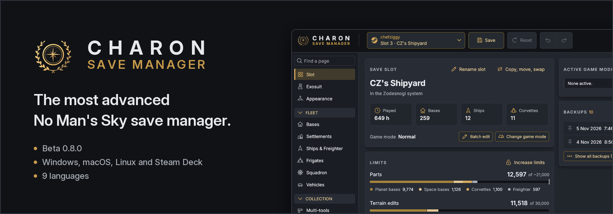

 

<table>
<tr>
<td width="33%" align="center"><a href="https://github.com/xX-Charon-Xx/charon-save-manager-release/releases/download/v0.8.0-beta/CharonSaveManager-0.8.0-beta-windows.exe"><b>Download for Windows</b></a> 64-bit</td>
<td width="33%" align="center"><a href="https://github.com/xX-Charon-Xx/charon-save-manager-release/releases/download/v0.8.0-beta/CharonSaveManager-0.8.0-beta-macos-arm.zip"><b>Download for macOS</b></a> Apple Silicon, M1 and newer</td>
<td width="33%" align="center"><a href="https://github.com/xX-Charon-Xx/charon-save-manager-release/releases/download/v0.8.0-beta/CharonSaveManager-0.8.0-beta-linux"><b>Download for Linux</b></a> Steam Deck too</td>
</tr>
</table>

<a href="https://discord.com/invite/charontheferryman"><b>Join our Discord</b></a> &nbsp;·&nbsp; <a href="https://charon.gg/"><b>Visit charon.gg</b></a>

 

> [!IMPORTANT]
> **This is a beta.** Every slot is backed up before it's written, and any backup can be restored from the Slot page.

 

<table>
<tr>
<td width="40%" valign="middle">
<h2>Total control over your save</h2>

Charon Save Manager opens your whole No Man's Sky save in an interface built like the game's own menus, in the game's own words and icons.

Open a slot and see its play time, bases, ships and corvettes, how close you are to the part and terrain-edit limits, where you are, and your backups.

</td>
<td width="60%">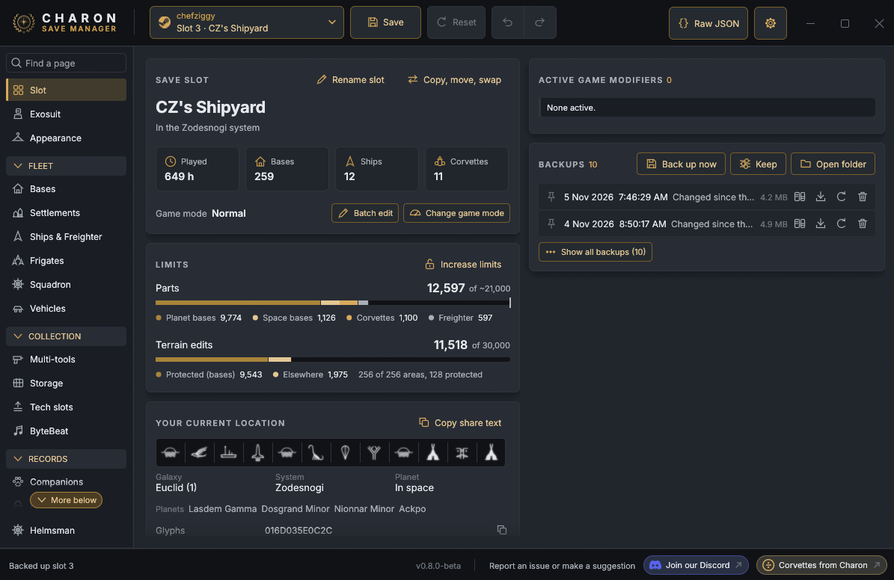</td>
</tr>
</table>

<table>
<tr>
<td width="33%" valign="top"><b>Fleet</b> Ships and corvettes part by part, the freighter, frigates, squadron and exocraft</td>
<td width="33%" valign="top"><b>Inventories</b> Every grid as the game draws it: select many, copy and paste, add any item, sort and stack</td>
<td width="33%" valign="top"><b>Bases and settlements</b> Part limits, terrain edits, perks, population and the decision waiting</td>
</tr>
<tr>
<td valign="top"><b>Look and multi-tools in 3D</b> Every part, colour and marking, with a live model</td>
<td valign="top"><b>Teleporter</b> All 256 galaxies, by glyphs, coordinates or your bases</td>
<td valign="top"><b>Fixes</b> Stuck missions and milestones, rewards that never arrived, old expeditions offline</td>
</tr>
</table>

Anything without its own page is a click away in a searchable tree of the whole save. You never edit a text file or guess at a hex value, every change can be undone and reviewed before you save, and every slot is backed up before it's written.

## Made for everyone

<table>
<tr>
<td width="40%" valign="middle">
<h3>Every language. Every computer. Every way you play.</h3>

<b>9 languages</b> Every page, button and message translated, with the game's own names for items, ships and places. Switches at once.

<b>4 platforms</b> Windows, macOS on Apple Silicon (M1 and newer), Linux and the Steam Deck. The same app, looking the same everywhere.

<b>Mouse or touch</b> Compact rows for mouse and keyboard, or Touch mode with bigger controls for the Steam Deck's screen.

<b>Nothing to install</b> One portable file. No .NET, Java, browser or installer. Download it and run it.

</td>
<td width="60%">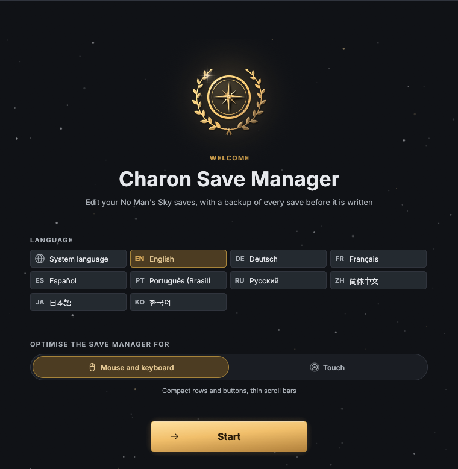</td>
</tr>
</table>

## Inventory management

Every inventory, the Exosuit, ships, multi-tools, exocraft, the freighter and every storage container, as the game's own grid with the game's own icons. Then do in seconds what takes minutes in the game.

<table>
<tr>
<td width="40%" valign="middle">
<h3>Select many, act once</h3>

Right-drag across slots, Shift-click a range, Ctrl-click one at a time, or Select all. Then right-click to <b>Copy</b> them (Ctrl+C) and <b>paste into empty slots</b> of any other inventory, or <b>Replace</b>, <b>Fill</b>, <b>Repair</b> or <b>Delete</b> them together.

Drag to move items; whatever is in the way swaps places, shown before you let go.

</td>
<td width="60%">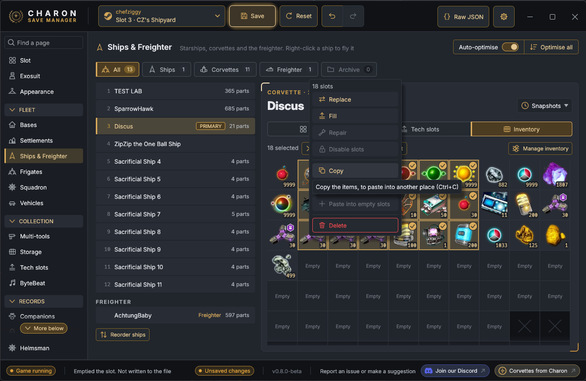</td>
</tr>
<tr>
<td width="60%">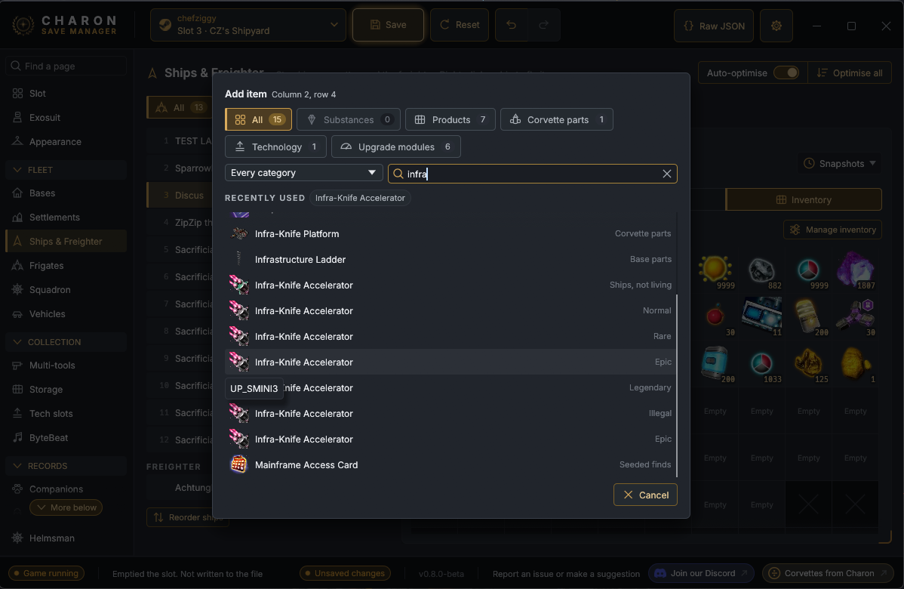</td>
<td width="40%" valign="middle">
<h3>Add any item</h3>

Search every item in the game by name or id, in the slot you picked. Narrow it to Substances, Products, Technology, Upgrade modules or Corvette parts, and pick an upgrade's class, from Normal to Illegal.

What you added last waits under <b>Recently used</b>.

</td>
</tr>
<tr>
<td width="40%" valign="middle">
<h3>Every inventory in one place</h3>

Storage lists every storage container, ship, multi-tool and exocraft. Search for an item and see how many you have and where they are.

Rename storage containers, and keep <b>Snapshots</b> of an inventory to restore later, there or in another inventory.

</td>
<td width="60%">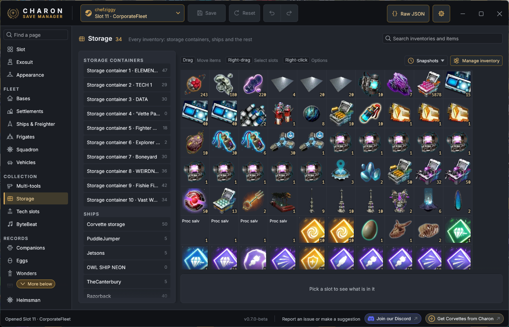</td>
</tr>
<tr>
<td width="60%">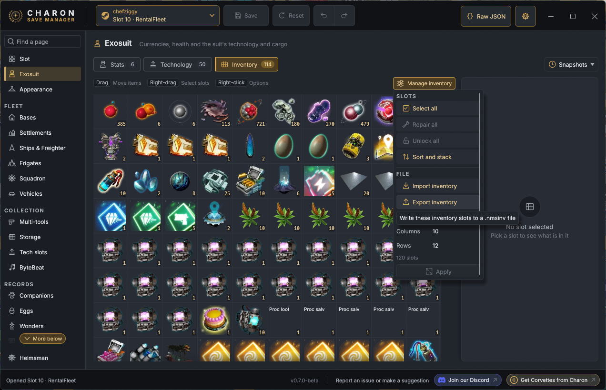</td>
<td width="40%" valign="middle">
<h3>Sort, resize, share</h3>

Sort and stack one inventory or every storage container, repair or unlock every slot, and resize a grid.

Share tech slots and inventories as <code>.nmstech</code> and <code>.nmsinv</code> files.

</td>
</tr>
</table>

## Ships, corvettes and freighter

<table>
<tr>
<td width="40%" valign="middle">
<h3>Every ship, part by part</h3>

Rebuild ships from the game's Starship Fabricator and paint them from the outfitter's swatches. Make a new ship in an empty slot, archive ships, and import or export ships and corvettes as <code>.nmsship</code> files or parts lists.

The <b>Optimiser</b> puts a corvette's most important parts first.

</td>
<td width="60%">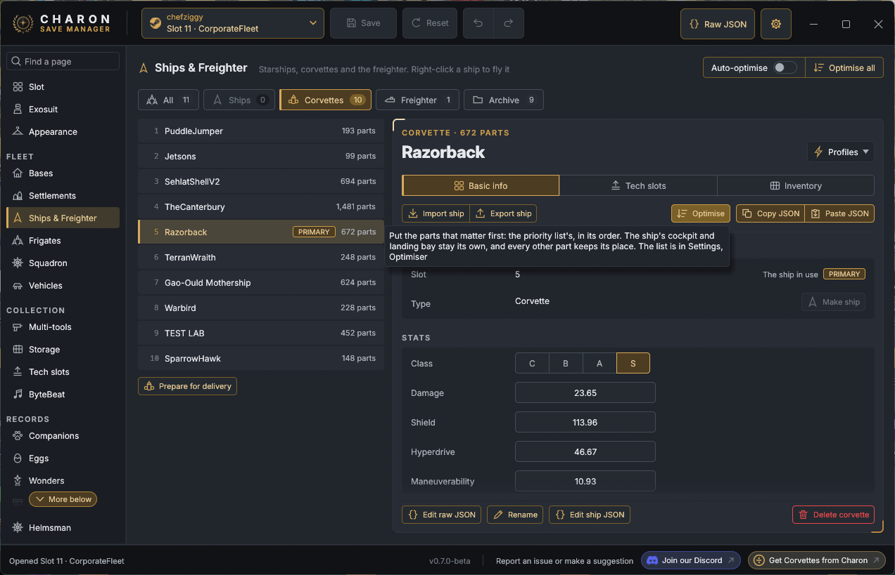</td>
</tr>
<tr>
<td width="60%">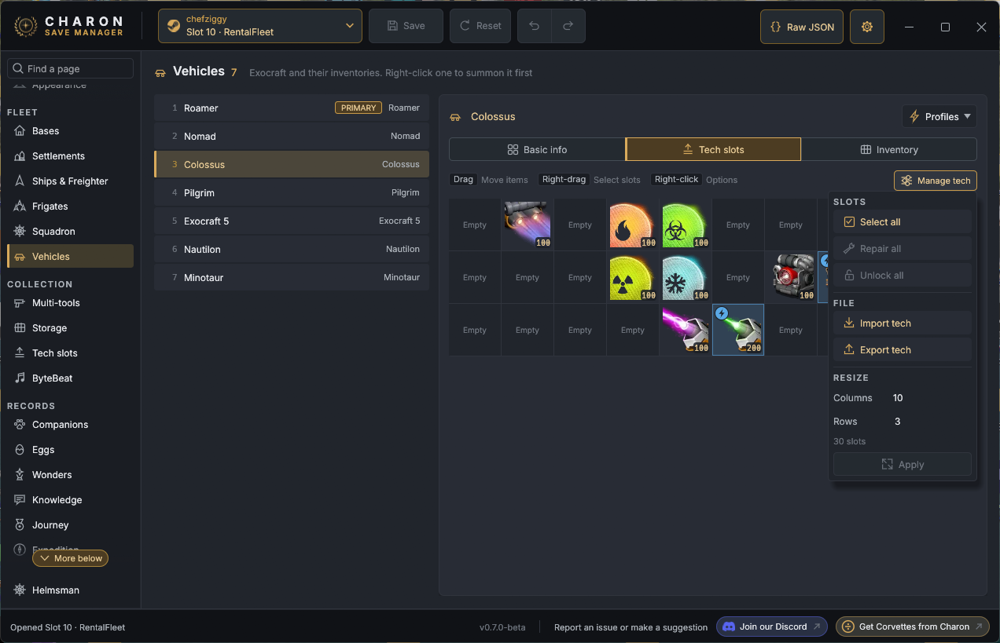</td>
<td width="40%" valign="middle">
<h3>Exocraft</h3>

Every exocraft with the same tech-slot and inventory grids: repair, unlock, resize, import and export. Summon one, or unlock a locked exocraft.

</td>
</tr>
<tr>
<td width="40%" valign="middle">
<h3>Frigates and freighter</h3>

Every frigate's grade, captain, stats and traits, with the game's names and effects. Rename, repair or remove one, and see the expeditions out.

Change your freighter's class, seeds and captain.

</td>
<td width="60%">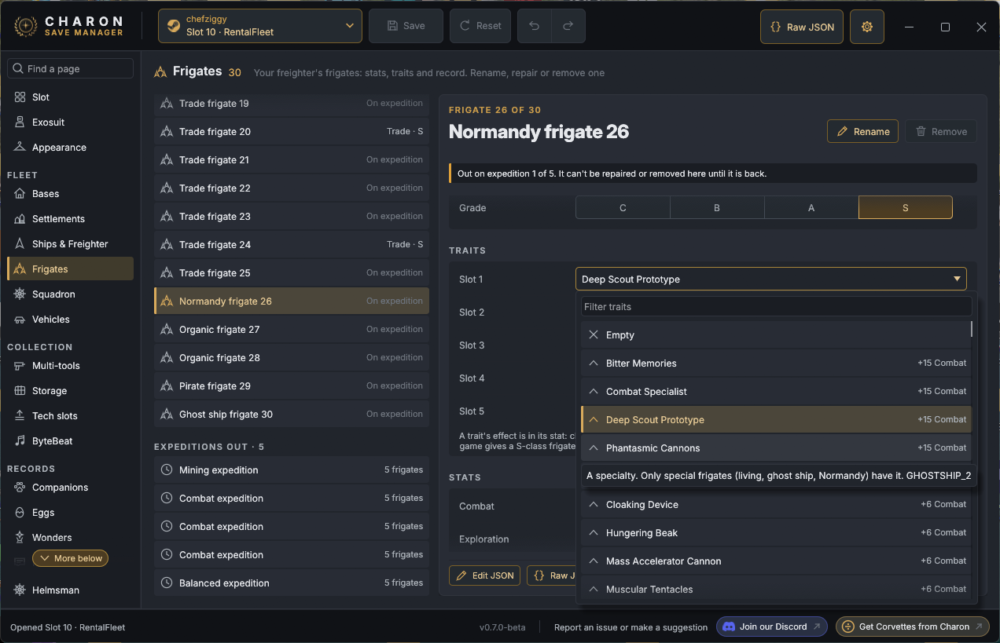</td>
</tr>
</table>

## Your look and your multi-tools, in 3D

<table>
<tr>
<td width="40%" valign="middle">
<h3>Appearance</h3>

Edit your race, body, every part, colour and marking, and watch the model change as you go.

Save outfits, use Presets, and import or export every outfit.

</td>
<td width="60%">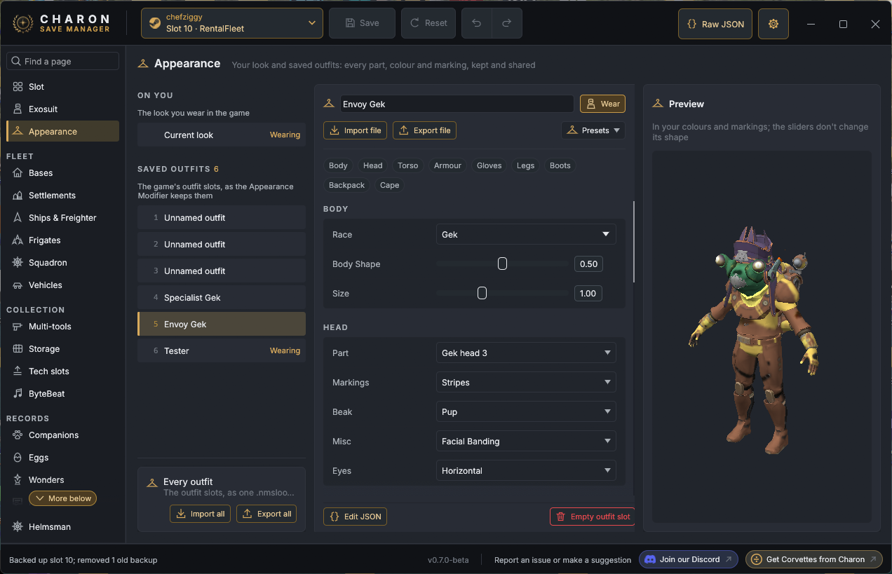</td>
</tr>
<tr>
<td width="60%">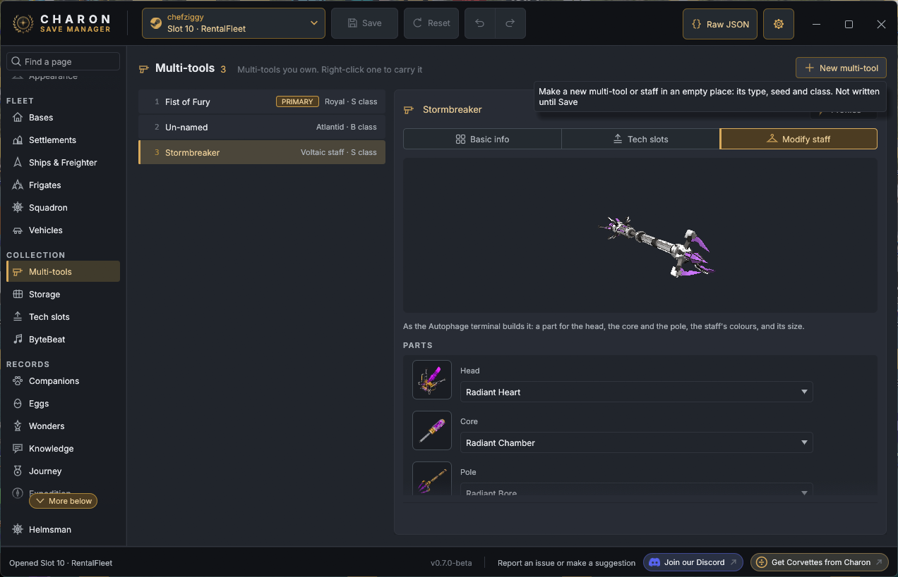</td>
<td width="40%" valign="middle">
<h3>Multi-tools and staffs</h3>

Multi-tools and Autophage staffs are built as the game's terminals build them, part by part, shown in 3D in their own colours.

</td>
</tr>
</table>

## Bases and settlements

<table>
<tr>
<td width="40%" valign="middle">
<h3>Bases</h3>

Search bases by name, planet, system or glyphs. Rename, teleport to, export, import or delete them.

See each base's wires, part limits and the terrain edits around it.

</td>
<td width="60%">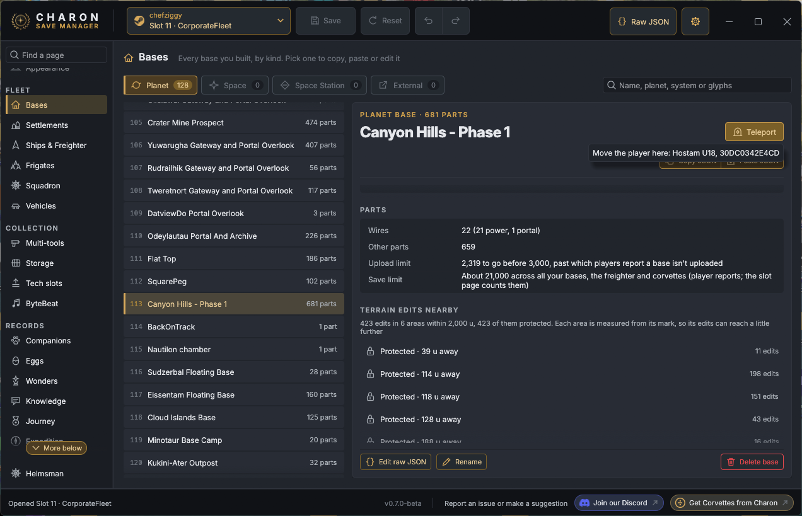</td>
</tr>
<tr>
<td width="60%">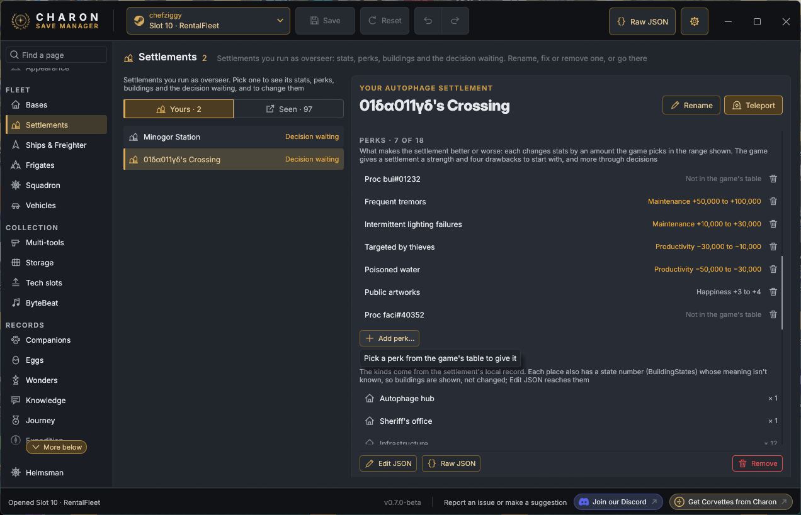</td>
<td width="40%" valign="middle">
<h3>Settlements</h3>

As overseer, change a settlement's population, race and stats within the game's ranges, give or take perks, and clear its troubles and the decision waiting.

</td>
</tr>
</table>

## Teleporter

<table>
<tr>
<td width="40%" valign="middle">
<h3>Go anywhere</h3>

Every base and saved place, searchable by name or glyphs. Save places to come back to from any save.

<b>Get me unstuck</b> lifts you out of rock or a building, and <b>Export</b> writes where you've been to a spreadsheet.

</td>
<td width="60%">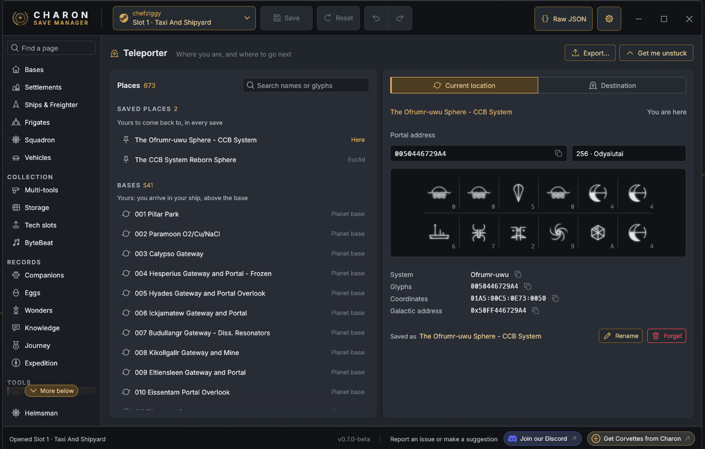</td>
</tr>
<tr>
<td width="60%">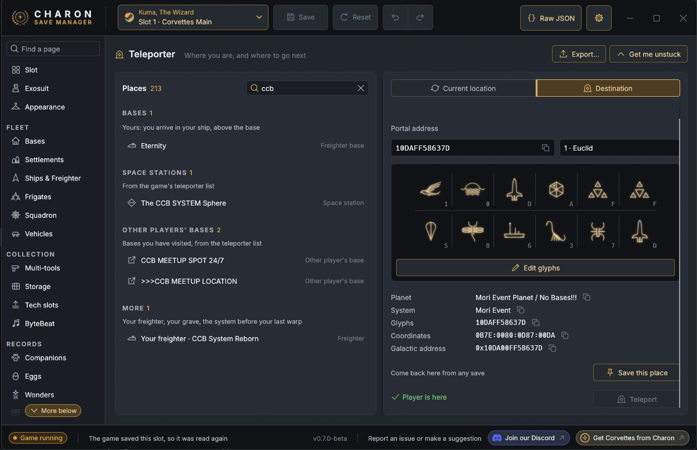</td>
<td width="40%" valign="middle">
<h3>By portal glyphs</h3>

Pick a destination by portal glyphs, coordinates or galactic address, in any of the 256 galaxies.

</td>
</tr>
</table>

## Companions, ByteBeat and everything else

<table>
<tr>
<td width="40%" valign="middle">
<h3>Companions</h3>

Change a companion's climate, size, trust, traits, moods and look seeds. Level it up for battles, reorder companions, and import or export them as <code>.nmspet</code> files.

</td>
<td width="60%">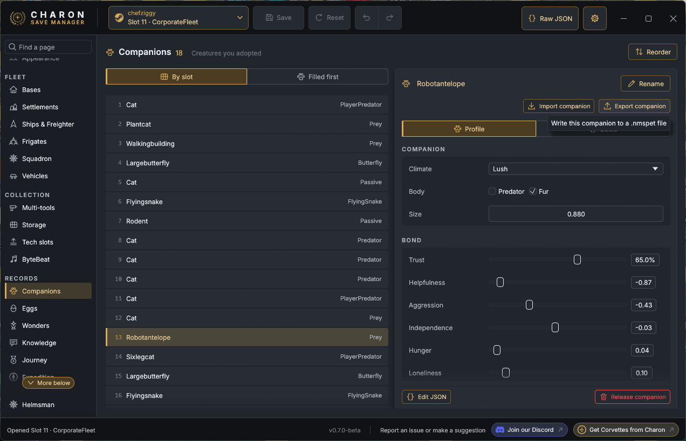</td>
</tr>
<tr>
<td width="60%">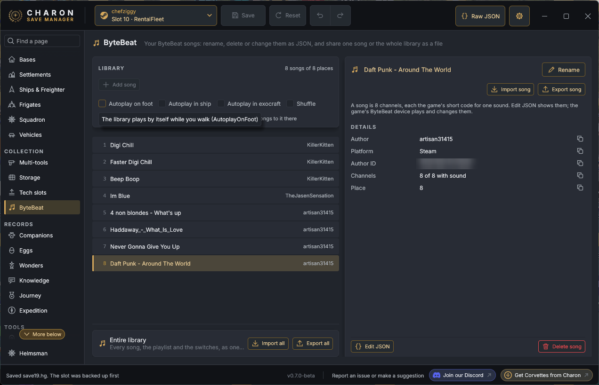</td>
<td width="40%" valign="middle">
<h3>ByteBeat</h3>

Rename, edit or delete your ByteBeat songs, and share one song or the whole library as a file.

</td>
</tr>
</table>

<b>And much more</b>

 

- **Fix what the game broke:** careful fixes for stuck missions and expedition milestones, **Claim again** for rewards that never arrived, and **Replay old expeditions** offline (1 to 23, and every Redux).
- **Increase limits:** one click writes a small game mod that lifts corvette and base build limits. No save is changed, and one click removes it.
- **Rewards:** expedition rewards, Twitch drops, Quicksilver shop items, titles and appearance parts, on the account or in the save.
- **Frigates and squadron, eggs, Wonders, knowledge and blueprints, journey and standing, game mode and difficulty, terrain edits, things built outside bases.**
- **Item catalogue:** every item with its recipes and uses. It works without a save.
- **Find a page (Ctrl+K):** search every base, ship, item and setting from one box.

## The whole save, as a tree

<table>
<tr>
<td width="40%" valign="middle">
<h3>Raw JSON</h3>

Anything without a page of its own is here: every value in the save as a tree you can search, filter and edit.

Jump from any page's JSON editor straight to its record.

</td>
<td width="60%">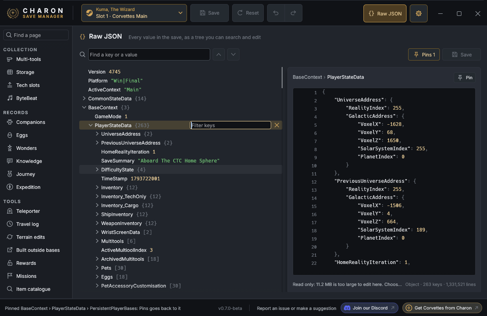</td>
</tr>
<tr>
<td width="60%">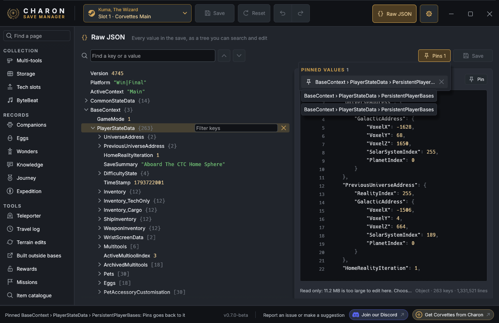</td>
<td width="40%" valign="middle">
<h3>Pins</h3>

Pin the values you come back to, and jump back to any of them from the <b>Pins</b> list.

</td>
</tr>
</table>

## Built to keep your saves safe

<table>
<tr>
<td width="50%" valign="top"><b>Automatic backups</b> The whole slot is backed up before every save, in <code>charon_backup</code> inside your save folder. Pin, compare and restore them.</td>
<td width="50%" valign="top"><b>Undo, Redo and Review changes</b> See exactly what will change, area by area, before you press Save.</td>
</tr>
<tr>
<td valign="top"><b>Checked before every write</b> A save the game changed in the meantime is never overwritten without asking.</td>
<td valign="top"><b>Rescue and compare</b> Open a slot that won't load, and compare any two saves.</td>
</tr>
<tr>
<td valign="top"><b>Copy, move or swap slots</b> Or copy a slot to another account.</td>
<td valign="top"><b>Read-only mode</b> Look around with no risk at all.</td>
</tr>
</table>

## Getting started

1. **Keep a copy of your save folder.** Every slot is backed up before saving, but this is a beta.
2. Download the file for your system from [Releases](https://github.com/xX-Charon-Xx/charon-save-manager-release/releases/latest) and run it.
   - **Windows:** the program isn't signed yet, so Windows may warn about an unknown publisher. Choose **More info**, then **Run anyway**.
   - **macOS:** unzip it. The first time, right-click the app and choose **Open** (or **System Settings › Privacy & Security › Open Anyway**).
   - **Linux / Steam Deck:** `chmod +x` the file, then run it.
3. Pick your slot in the title bar, make your changes and press **Save**.
4. Save from the game's main menu, or with the game closed.

To check a download, compare its SHA-256 with the `SHA256SUMS` file on the release.

## Requirements

No Man's Sky on **Steam or GOG** (PC). Xbox / Game Pass and PlayStation saves aren't supported.

| System | File | Status |
|---|---|---|
| **Windows** | `.exe` | Tested with real saves and in the game |
| **macOS** (Apple Silicon: M1 and newer) | zipped `.app` | Built, not yet tried on a Mac |
| **Linux / Steam Deck** | executable | Built, not yet tried on a real machine |

Feedback from Mac, Linux and Steam Deck players is very welcome.

## Feedback

Most features have been tried in the game, but not all of them. If something looks wrong, tell us which save slot and what you did, in [Issues](https://github.com/xX-Charon-Xx/charon-save-manager-release/issues) or on [our Discord](https://discord.com/invite/charontheferryman). **Settings › About › Platform report** copies the details we need.

## Credits

- [MBINCompiler](https://github.com/monkeyman192/MBINCompiler) by monkeyman192 and contributors, for the save key names.
- The old expedition files for offline replay are by cwmonkey.
- The full list of libraries and licences is under **Settings › About**.

 

<a href="https://charon.gg/">charon.gg</a> · <a href="https://discord.com/invite/charontheferryman">Discord</a> · <a href="https://github.com/xX-Charon-Xx/charon-save-manager-release/releases">All releases</a>
  
No Man's Sky is a trademark of Hello Games. This is a fan-made tool. It isn't made or endorsed by Hello Games.

